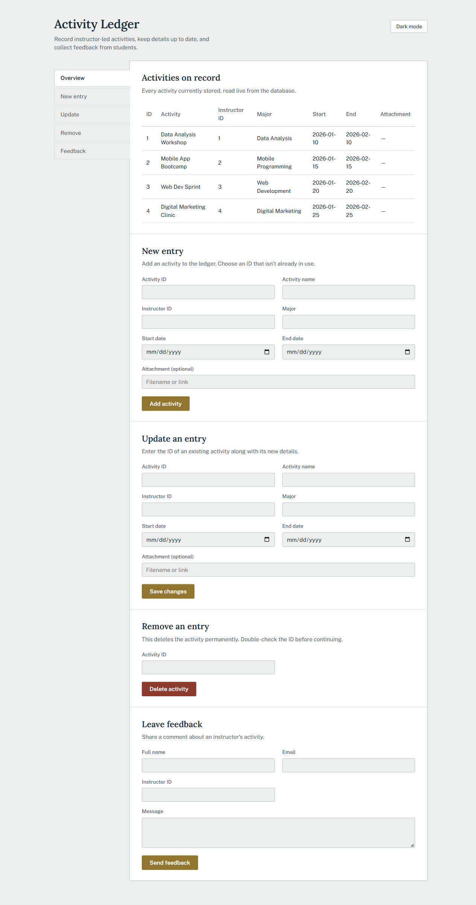
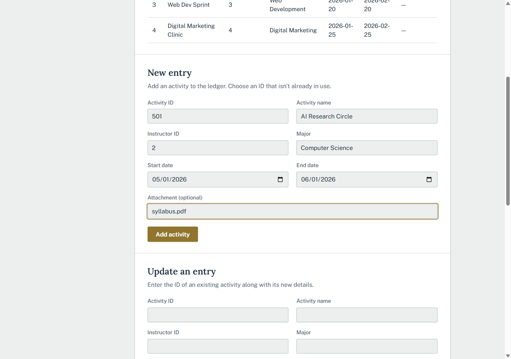
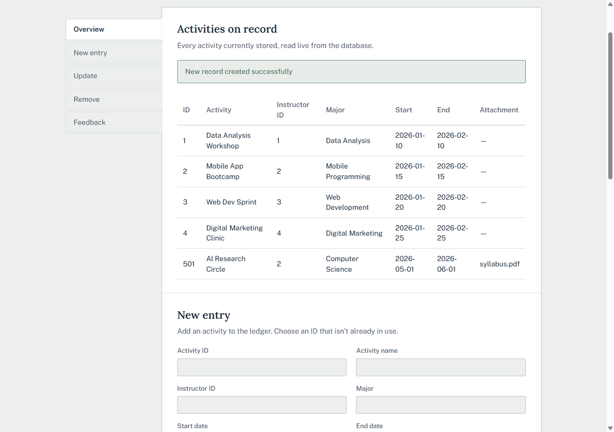
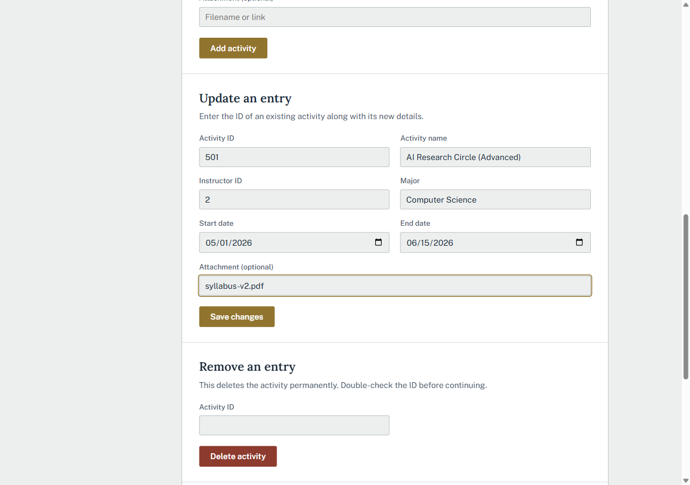
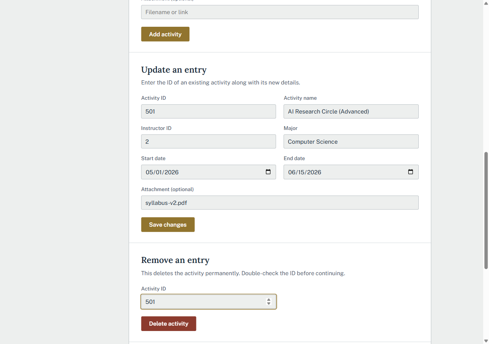
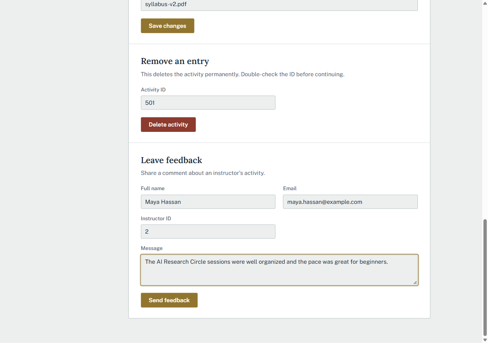
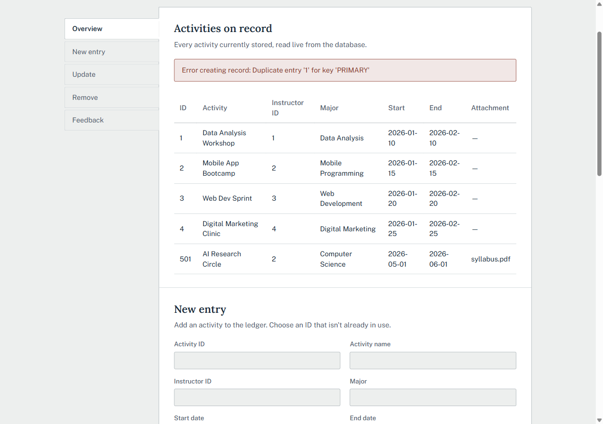
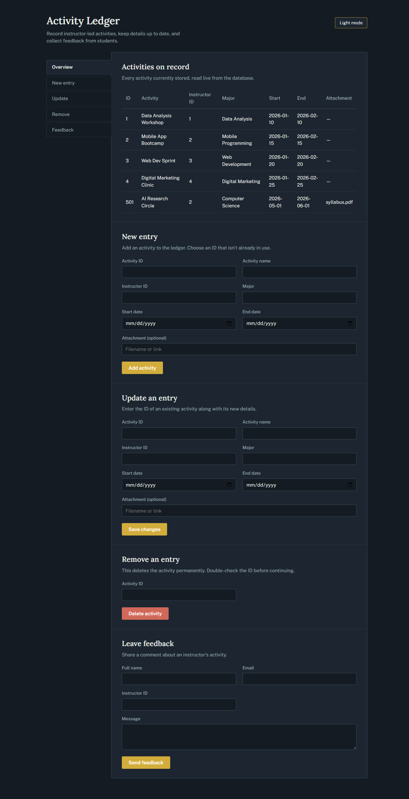
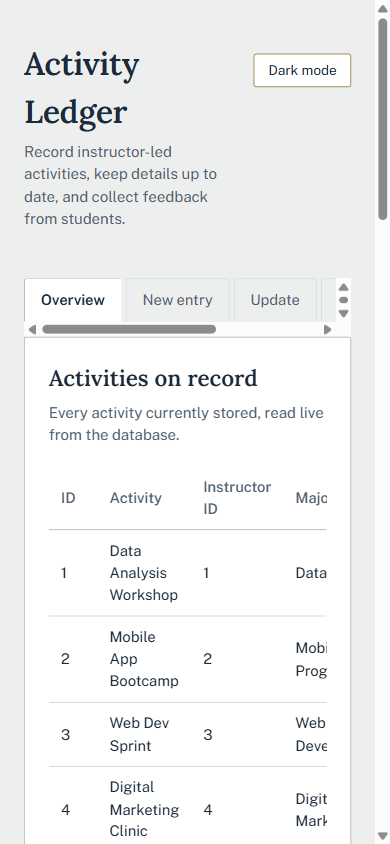

# Activity Ledger

  

A small CRUD application for managing instructor-led university activities and collecting student feedback — built as a university Agile Software Development course project and restored/modernized here.

## Overview

Activity Ledger lets staff record activities run by instructors (workshops, clubs, bootcamps — anything with a start date, end date, and major/track), keep those records up to date, and lets students leave feedback on an instructor's activity. It's deliberately simple: no authentication, no framework — just PHP talking directly to MySQL through `mysqli`, with a hand-rolled MVC-ish split between view, controller, and data layer.

## Features

- **Browse** every activity on record in a live table read straight from the database
- **Create** a new activity with ID, name, instructor, major, dates, and an optional attachment reference
- **Update** an existing activity's details
- **Remove** an activity by ID
- **Submit feedback** on an instructor's activity (name, email, instructor ID, message)
- Clear success/error messages for every action, with input validation on all forms
- Light and dark themes

## Screenshots

| | |
|---|---|
|  **Overview** — activities on record, live from the database |  **New entry** — adding an activity |
|  **Success feedback** after creating a record |  **Update** an existing activity |
|  **Remove** an activity by ID |  **Feedback** form |
|  **Error feedback** (duplicate ID) |  **Dark mode** |
|  **Responsive** layout on mobile | |

## Tech stack

- **Language**: PHP 8.1
- **Database**: MySQL / MariaDB (`mysqli`, prepared statements throughout)
- **Frontend**: Server-rendered HTML + hand-written CSS (no build step), ~70 lines of vanilla JS for the theme toggle and active-tab highlighting
- **Fonts**: Lora (headings), Public Sans (UI/body) via Google Fonts
- **Dev tooling used while restoring**: XAMPP (PHP 8.1.6 + MariaDB 10.4.24), PHP's built-in dev server, Playwright (for screenshot verification)

No Composer dependencies, no JS framework, no build pipeline — matches the original project's scope.

## Project structure

```
.
├── activitydetails.php          # View: renders the ledger UI and reads activities for display
├── ActivityDetailsController.php# Controller: routes POST requests to the right CRUD/feedback action
├── ActivityDetailsCRUD.php      # Data layer: Activity/Feedback models + mysqli CRUD methods
├── assets/
│   ├── style.css                # All styling, including light/dark theme variables
│   └── app.js                   # Theme toggle + active-tab highlighting (vanilla JS)
├── database/
│   └── schema.sql                # Creates the database, tables, and sample rows
└── docs/
    └── screenshots/              # README screenshots
```

## Prerequisites

- PHP 8.1+ with the `mysqli` extension (bundled with most PHP installs)
- MySQL or MariaDB 10.4+
- Any way to run PHP's built-in server, or Apache/XAMPP

## Installation & running

1. **Create the database.** Run the schema against your MySQL/MariaDB server:
   ```bash
   mysql -u root -p < database/schema.sql
   ```
   This creates the `activity_details_app` database with `activity_details` and `feedback` tables, plus four sample activities.

2. **Point the app at your database**, if different from the defaults. Edit the connection settings at the top of `ActivityDetailsCRUD.php::__construct()`:
   ```php
   $servername = "127.0.0.1";
   $username   = "root";
   $password   = "";
   $database   = "activity_details_app";
   $port       = 3307; // change to match your MySQL server's port (3306 is the usual default)
   ```

3. **Run it** with PHP's built-in server from the project root:
   ```bash
   php -S 127.0.0.1:8000
   ```
   Then open `http://127.0.0.1:8000/activitydetails.php`.

   (Any standard PHP host — Apache, Nginx+PHP-FPM, XAMPP's `htdocs` — works too; just drop the project folder in and visit `activitydetails.php`.)

## How to use

The page is a single ledger with five sections, reachable from the tabs on the left (or the top on mobile):

- **Overview** — see every activity currently stored
- **New entry** — add an activity; pick an ID that isn't already used
- **Update** — change an existing activity by its ID
- **Remove** — delete an activity by ID
- **Feedback** — leave a comment about an instructor's activity

Every submission redirects back to the Overview-adjacent section with a success or error banner explaining what happened.

## Testing

This project has no automated test suite (none existed in the original, and the logic is simple enough that a smoke test covers it). To manually verify the core flows:

1. Start the app as described above.
2. Create an activity, confirm it appears in the Overview table with a success banner.
3. Update it, confirm the changes are reflected.
4. Submit feedback for it.
5. Delete it, confirm it disappears from the table.
6. Try creating an activity with an ID that already exists — confirm you get a clear error banner instead of a crash.

## Restoration notes

This project was restored from a 3-file, no-database, non-git state. Changes made:

**Bugs fixed:**
- Feedback submissions silently never saved: the controller only processed requests where `$_POST['Id']` was set, but the feedback form never sent an `Id` field. Routing was restructured to check per-action instead of gating everything behind `Id`.
- The feedback form's submit button had no `name` attribute, so `isset($_POST['feedback'])` could never be true — added `name="feedback"`.
- The delete form posted `name="id"` (lowercase) while the controller read `$_POST['Id']` (uppercase) — form field renamed to match.
- On PHP 8.1, `mysqli` throws exceptions on query errors by default instead of returning `false`, which meant every `if ($stmt->execute())` error-handling branch in the codebase was dead code and any DB error (e.g. a duplicate ID) crashed the app with an uncaught exception. Fixed by setting `mysqli_report(MYSQLI_REPORT_OFF)`, restoring the behavior the original code was written against.
- Output wasn't escaped before being echoed (reflected/stored XSS risk) — all dynamic values are now passed through `htmlspecialchars()`.
- Deleted-by-ID input wasn't type-checked before being interpolated into a response string — now cast to `int`.

**Database:** No schema existed in the original handoff. Added `database/schema.sql` defining `activity_details_app` with tables matching the `Activity`/`Feedback` model classes exactly, plus sample data matching the activities shown in the original mockup table.

**Dependency/environment notes:** Developed and tested against PHP 8.1.6 and MariaDB 10.4.24 (via XAMPP). No framework or package manager was introduced.

**GUI modernization:** The original UI was one unstyled HTML page with a hardcoded, unrelated sample table sitting above the real (empty) data loop. It's been rebuilt as a single-page "ledger" with:
- A folder-tab navigation (Overview / New entry / Update / Remove / Feedback) instead of five stacked forms
- Proper labels, input types (`number`, `date`, `email`), and `required`/`maxlength` validation on every field
- In-page success/error banners instead of a bare text response on a blank page
- Light and dark themes (persisted via `localStorage`, respects `prefers-color-scheme`)
- A responsive layout that collapses the tab sidebar into a horizontal scroller on small screens

The underlying CRUD/feedback logic in `ActivityDetailsCRUD.php` was not rewritten — the GUI calls the same `create()`, `update()`, `delete()`, `feedback()`, and `readAllActivities()` methods that existed before.

## Known limitations & future improvements

- **No authentication or authorization.** Anyone with access to the app can create, update, or delete any activity, or submit feedback as anyone. The original project had no auth system at all; adding one would be a substantial new feature rather than a restoration fix, so it's flagged here instead. A real deployment should add session-based auth and scope `update`/`delete` to the activity's owning instructor.
- **No CSRF protection** on the forms.
- Activity IDs are chosen manually rather than auto-generated, matching the original schema design — a production version would likely make `Id` auto-increment.
- No automated test suite.

## Author

**[Your Name]**
[Your GitHub] · [Your LinkedIn/Website]

## License

MIT — see [LICENSE](LICENSE).
